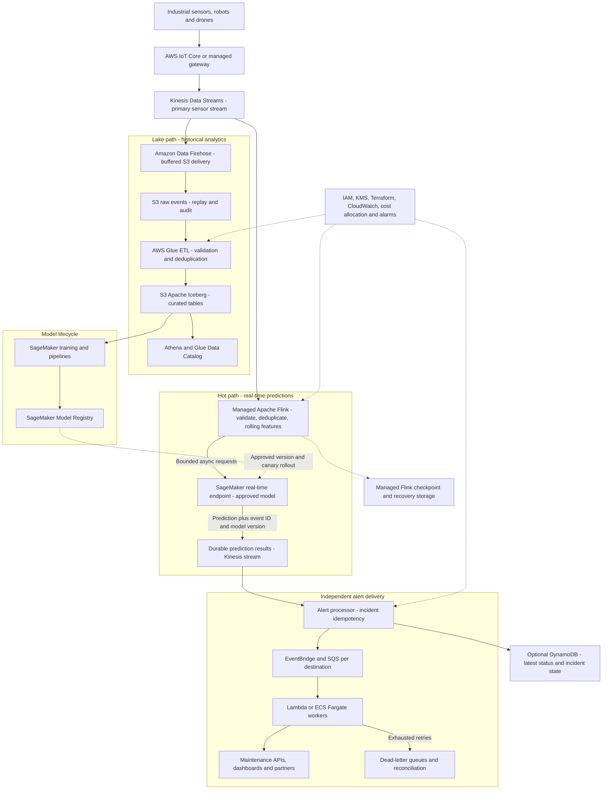

# Design 2 — Cost-Optimized AWS-Native Industrial IoT Platform

**Interview:** Platform Data Engineer — 60-minute system design  
**Architecture:** AWS-native, without EKS/Kubernetes or Databricks  
**Status:** Proposed design; load testing and regional pricing validation required  
**Scope:** 100,000 sensor events/sec sustained; 300,000/sec burst; <2 seconds p99 cloud-ingest-to-prediction-publication for eligible events.

## 1. Executive summary

Use AWS IoT Core or managed ingestion gateways, Amazon Kinesis Data Streams, Amazon Managed Service for Apache Flink, Amazon Data Firehose, Amazon S3, AWS Glue, Apache Iceberg, Athena, and Amazon SageMaker. Store the latest status and incident state in DynamoDB **only where external services require them**. EventBridge/SQS workers deliver alerts independently. Neither EKS nor Databricks is required in this alternative design.

**Important interview caveat:** The actual job description explicitly includes Databricks Delta Lake, MLflow and Model Serving. Present this as a **cost-optimized alternative**, not as a unilateral proposal to remove the existing platform. Confirm enterprise standards, migration costs, team capabilities and requirements before choosing.

## 2. Architecture (GitHub-compatible Mermaid)

**Interpretation:** Both the real-time Flink application and the S3 delivery service consume independently from Kinesis. A high-latency Glue job cannot block the inference path. The arrow from the model registry denotes an out-of-band deployment, not a per-event database call.

## 3. Requirements and SLAs

| Requirement | Proposed definition |
|---|---|
| Normal sustained ingress | 100,000 records/second |
| Burst ingress | 300,000 records/second, duration to be confirmed |
| Mean input payload | 1 KB, excluding protocol overhead |
| Prediction latency | p99 < 2 seconds from accepted cloud stream record to durably published prediction |
| Inference frequency | Only qualified events / updated per-device features; not necessarily every raw event |
| Lake freshness | Proposed target: 99% of validated data queryable within 5–15 minutes; negotiate |
| Delivery semantics | At-least-once transport plus durable idempotent business effects |
| Availability | Proposed 99.9% service SLO; multi-AZ design |
| Source schema | Protobuf/Avro + compatible schema versions |
| Analytical format | Iceberg metadata + Parquet data files on S3 |

**Clarify in the interview:** Is the two-second budget measured from device measurement (including network disruption) or cloud acceptance? Does it cover actual external maintenance API acknowledgment? What is burst duration? Does every reading need inference? These answers materially change the cost and architecture.

## 4. Capacity planning

At 100k x 1 KB, source writes are approximately **100 MB/s**, **8.64 billion events/day**, and **8.64 TB/day raw**. At 300k records/sec, input is approximately **300 MB/s**. These are decimal units before compression, replicas and metadata.

For **Kinesis provisioned mode**, a shard ordinarily supports up to **1 MB/s or 1,000 records/s write throughput**. Initial minimum estimates are 100 shards for the baseline and 300 shards for the burst; at 30% extra capacity the rough planning figures become 130 and 390 shards. Real shard sizing must account for hot keys, record sizes, regional quotas and actual traffic. Shard resizes are asynchronous; do not assume immediate accommodation of a 3x spike.

At 300k events/sec and 1 KB average size, a 15-minute burst produces **270 GB of source data**. If the hot path only handles 200k/sec, backlog grows by 100k/sec and reaches **90 million records in 15 minutes**. Replay protects durability, **not** the two-second SLO. Prewarm or provision headroom for contractually required bursts.

### Inference sizing example

If 10% of 300k incoming events qualify, the endpoint needs **30,000 predictions/sec**. With average 100 ms service time, ideal average in-flight concurrency is around **3,000 requests** (Little's Law). This is not a count of hosts or GPU replicas. The endpoint must be benchmarked with batching, p99 queuing, feature lookup, CPU/GPU utilization and model-specific costs. Prefer per-device/window/risk-triggered predictions where safe.

## 5. Detailed event workflow

1. **Device sends event:** e.g. `device_id`, `event_id`, `event_time`, monotonic `sequence_number`, `schema_version`, temperature and vibration. Device authentication and TLS happen at the edge. Offline devices buffer with bounded retention and replay when connected.
2. **Gateway publishes to Kinesis:** use `device_id` as the partition key if device-level ordering is required. Producers batch requests, inspect partial failures and retry with exponential backoff and jitter.
3. **Managed Flink reads stream:** independent source reads shards; enforce schema contract; quarantine corrupt inputs; deduplicate using `event_id` with a documented retention horizon.
4. **Flink computes rolling features:** `keyBy(device_id)` maintains keyed state for five-minute temperature averages, vibration maxima, and pressure trends; processing uses event-time logic and bounded lateness rules.
5. **Inference trigger:** call the endpoint at a controlled interval, on meaningful feature changes, or on rule-based elevated risk, while retaining all validated readings for analytics. Use bounded asynchronous calls, timeouts, circuit breakers and backpressure.
6. **SageMaker performs inference:** an approved, already-trained model returns risk probability and model version. Record feature time, event ID, latency and any degraded-mode decision.
7. **Persist prediction result:** publish to a durable result stream. If the inference call is retried, deduplicate result writes or make consumers idempotent; Flink checkpoints alone cannot guarantee exactly-once external effects.
8. **Alert router creates incident:** apply severity threshold and hysteresis; conditional update of incident state, so repeated high-risk readings do not create duplicate tickets.
9. **EventBridge/SQS delivers alerts:** independent destinations, worker retries with backoff, DLQ and reconciliation. External APIs must accept idempotency keys or have a reconciliation strategy.
10. **Lake pipeline independently lands data:** Firehose buffers source records to raw S3; Glue batch/stream jobs validate, deduplicate, and build curated Iceberg/Parquet tables; Athena queries them. Do not treat direct Firehose delivery as a guaranteed validated Silver table.
11. **Model training uses history:** SageMaker Pipelines trains and evaluates on curated data; model artifacts and approvals go into Model Registry; a canary or rollback procedure updates serving endpoints.

## 6. Technology decision matrix

| Requirement | Selected AWS native service | Reason / alternative |
|---|---|---|
| Edge integration | IoT Core | Device identity and MQTT; gateways for proprietary protocols |
| Real-time durable ingress | Kinesis Data Streams | Fully managed stream; MSK if Kafka ecosystem matters |
| Stateful streaming | Managed Apache Flink | No EKS operator or node management |
| Raw historical landing | Data Firehose to S3 | Buffered low-ops delivery; review pricing and data freshness |
| Trusted lakehouse tables | Glue + Iceberg on S3 | Parquet-backed analytics with transactional table metadata |
| Queries | Athena | Serverless pay-per-scanned-query; tune files and partitions |
| ML training/registry | SageMaker | No Databricks platform dependency |
| Online inference | SageMaker real-time endpoint | Always-on model capacity; benchmark cost and latency |
| Alert fan-out | EventBridge + SQS | Per-destination isolation, retries and DLQ |
| Shared latest device/alert status | DynamoDB, optional | Only if APIs need a low-latency operational lookup |
| Workflow orchestration | Step Functions / EventBridge Scheduler | No Argo Workflows requirement |
| Monitoring & IaC | CloudWatch + Terraform | AWS native metrics and reproducible deployments |

## 7. Cost model and optimization

**Do not assert an exact monthly saving without a load test, a chosen Region and AWS Pricing Calculator quotes.** Cost depends on running utilization, number of Flink KPUs, stream capacity mode, Firehose delivery, Glue DPU-hours, stored TB, Athena scans and SageMaker inference requests/replicas.

| Component | Cost drivers | Optimization |
|---|---|---|
| IoT Core | Messages, connectivity and routing | Batch small readings, filter noise at edge where safe |
| Kinesis | Shard hours/throughput or on-demand usage, PUT payload units, retention and EFO | Test provisioned vs on-demand, partition distribution, batch |
| Managed Flink | KPU hours, application/storage charges | Efficient state, avoid unnecessary enrichments, autoscale carefully |
| Firehose | Ingest/delivery volume, processing and optional transforms | Compress files, tune buffers, avoid duplicate copies |
| S3 | Stored bytes, requests, lifecycle tier and retrieval | Parquet compression, lifecycle and retention controls |
| Glue | DPU-hours and job runtime | Incremental processing and right-size batch jobs |
| Athena | Bytes scanned / capacity if provisioned | Partition prune, column-select, compact Parquet |
| SageMaker | Endpoint instance uptime, training and associated resources | Trigger fewer predictions, right-size endpoints, benchmark CPU/GPU |
| EventBridge/SQS/Lambda | Events, requests and execution duration | Publish *alerts* rather than every normal prediction downstream |
| DynamoDB, optional | Reads/writes/storage | Store latest device status only when queried externally |
| Network | Cross-AZ/region traffic, NAT gateway processing, endpoints | VPC endpoints and network-local communication as appropriate |

**Sample Flink-only illustrative calculation:** at the AWS documentation example rate of $0.11/KPU-hour in us-east-1, 20 application KPUs + one additional KPU for 730 hours would cost approximately **$1,686.30** for KPU time alone, excluding running/durable storage and every other AWS service. This is *not* the cost of the entire 100k/sec system, and 20 KPUs is *not* validated for this workload.

### Cost evaluation plan

- Collect sustained vs peak events/sec and the average and p99 payload sizes.
- Measure Flink KPU needs and state sizes with replay/load testing at 100k and 300k/sec.
- Benchmark inference with 1%, 10%, and 100% prediction-trigger rates.
- Estimate full-month S3 data retention after compression and lifecycle changes.
- Use AWS Pricing Calculator for the target Region, and compare to Databricks DBU + underlying cloud + engineering costs.
- Track **cost per million accepted sensor records**, **cost per thousand successful predictions**, and **cost per delivered critical incident**.

## 8. Reliability and correctness

**Source:** configure stream retention longer than maximum expected outages plus recovery time; edge buffers survive temporary disconnection; monitor `WriteProvisionedThroughputExceeded` and iterator age.

**Flink:** enable checkpoints and application recovery, monitor checkpoint duration, failures, backpressure, restart counts and state size. Checkpointed computation does not make side effects at external SageMaker APIs exactly-once.

**Delivery:** deterministic incident IDs, durable conditional state transitions, SQS redrive/DLQs, idempotent destinations and reconciliation. Separate transient timeout from permanent schema/auth errors.

**Late events:** keep event timestamp separate from arrival timestamp. Use watermarks and late-data policies for feature computation; do not silently replace current operational state with old readings.

**Schema:** version Protobuf/Avro contracts; validate producer upgrades before rollout. Keep incompatible payloads in quarantine, not in trusted Silver/Iceberg tables.

**Availability:** deploy across multiple AZs where the service supports it. Explicitly decide cross-region RPO/RTO; failover and duplicate handling require drills.

## 9. Observability and acceptance tests

| Signal | Suggested alert or test |
|---|---|
| End-to-end prediction p99 | Below 2 seconds under agreed baseline and spike envelope |
| Kinesis throttling | Alert on nonzero sustained producer throttling |
| Consumer iterator age | Alert when rising beyond agreed recovery budget |
| Flink checkpoint failures | Alert on repeated failures, stalled state restoration |
| Endpoint saturation | Alert on queueing, p99 latency, 5xx and capacity shortfall |
| Lake completeness | Reconcile event counts, duplicates and invalid records |
| SQS oldest message age | Alert if partner integrations fall behind |
| DLQ | Alert and define a documented replay procedure |
| Model quality | Monitor data/feature drift, and accuracy when labels become available |

**Test scenarios:** 3x spike, hot device ID, zone interruption, slow endpoint, schema change, replay after outage, external partner down, and model canary rollback. Test recovery while maintaining business idempotency.

## 10. Security and compliance

- Device certificates and encryption in transit; restrict device publish rights.
- Least-privilege IAM for Flink, Firehose, Glue, SageMaker and alert workers.
- KMS encryption for stream, S3 and queues; private connectivity/VPC endpoints where beneficial.
- CloudTrail and access logs; Glue Data Catalog/Lake Formation governance as needed.
- PII/data classification, deletion and retention rules; avoid recording secrets or full sensitive payloads in application logs.
- Terraform modules, CI/CD reviews, deployment approvals and isolated environments/accounts.

## 11. Tradeoffs to say out loud

1. **Managed Flink versus EKS Flink:** less Kubernetes infrastructure/operations, but KPU charges, service limits and less runtime control; benchmark total cost.
2. **No Databricks:** fewer vendors and platform fees; loses Databricks-specific workflows, Unity Catalog capabilities and the JD's requested Delta/MLflow environment unless replaced deliberately.
3. **Iceberg versus Delta:** native Glue/Athena integration may favor Iceberg; Delta may be a requirement if interoperating with existing Databricks users. Both have migration and table maintenance costs.
4. **Provisioned vs on-demand Kinesis:** predictable traffic may favor provisioned; spikes may favor on-demand/prewarming, with capacity and pricing limits.
5. **Always-on SageMaker endpoint:** fast serving, but idle cost; on-demand/serverless alternatives must be latency-tested for cold-start risk and availability.
6. **Every-event versus event-triggered inference:** frequency strongly affects cost; reduction is valid only when the required detection accuracy and time-to-detection are preserved.

## 12. Suggested 60-minute interview structure

| Minutes | Topic |
|---|---|
| 0–5 | Clarify SLO boundaries, event size, burst duration and inference frequency |
| 5–12 | Capacity math and event contract |
| 12–25 | Walk through Mermaid diagram, hot path and lake path |
| 25–35 | Flink keyed state, online inference and downstream reliability |
| 35–45 | 3x burst, hot shards, retry/backpressure and scaling |
| 45–53 | Iceberg/Glue/S3, model lifecycle, security and SLO monitoring |
| 53–60 | Cost alternatives, tradeoffs and summarize |

### Two-minute spoken summary

> I would start with Kinesis as a durable ingestion backbone for industrial sensor events. A managed Flink application performs schema validation, device-keyed feature aggregation and bounded asynchronous calls to a SageMaker real-time prediction endpoint. The prediction is committed to a results stream and alerts are distributed through independently retryable SQS integrations with idempotent incident handling. A separate Firehose-to-S3 and Glue/Iceberg path supports historical analytics and SageMaker training without blocking the two-second inference objective. This AWS-native option avoids EKS and Databricks operating dependencies, but I would not assume it is the lowest-cost choice until measuring Kinesis capacity, Flink KPU utilization, model-serving throughput, data retention, and total engineering cost. Because the existing JD names Databricks and Delta, I would present this as an alternative to compare with the company's established stack.

## 13. Official references

- [Kinesis Data Streams quotas and limits](https://docs.aws.amazon.com/streams/latest/dev/service-sizes-and-limits.html)
- [Kinesis capacity modes and shards](https://docs.aws.amazon.com/streams/latest/dev/working-with-streams.html)
- [Managed Apache Flink billing](https://docs.aws.amazon.com/managed-flink/latest/java/how-pricing.html)
- [Managed Apache Flink pricing](https://aws.amazon.com/managed-service-apache-flink/pricing/)
- [AWS Glue support for Apache Iceberg](https://docs.aws.amazon.com/glue/latest/dg/aws-glue-programming-etl-format-iceberg.html)
- [Amazon SageMaker real-time inference](https://docs.aws.amazon.com/sagemaker/latest/dg/realtime-endpoints.html)
- [Amazon Data Firehose](https://docs.aws.amazon.com/firehose/latest/dev/what-is-this-service.html)

---
**Interview note:** The most credible cost optimization is not merely replacing products: it is lowering total cost per useful prediction while preserving freshness, accuracy and delivery reliability.
